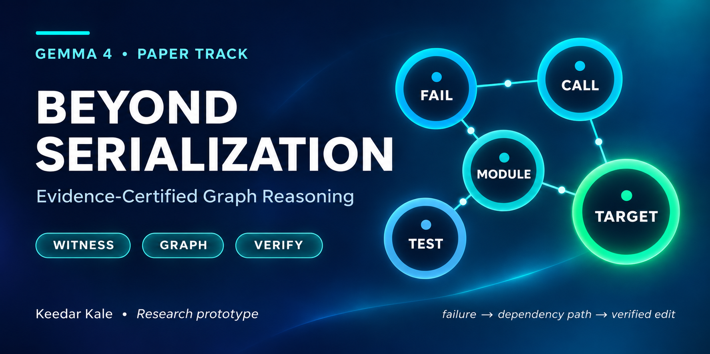

# Beyond Serialization — Evidence-Certified Graph Reasoning



**Author:** Keedar Kale  
**Project:** [Google DeepMind — Gemma 4 Developer Agent Paper Track](https://www.kaggle.com/competitions/gemma-4-developer-agent-paper)  
**Type:** Original research prototype / reproducible synthetic diagnostic, **not** a full Gemma 4 agent or a scored competition submission.

This repository translates *Beyond Serialization: Structure-Aware Integration of Graphs and Large Language Models for Reliable Multi-Hop Reasoning* into software-engineering research. It studies whether failing-test-conditioned **static repository graphs** help identify likely faulty functions under a constrained context budget, and whether the graph paths shown to an agent can be checked mechanically.

## What actually works

- **Python AST graph extraction:** functions and statically resolvable imported or local calls.
- **Two ranking baselines:** lexical name/docstring overlap and fixed-weight, test-conditioned graph routing.
- **Auditable witness certificates:** directed test-to-target graph paths and SHA-256 hashes of cited source files; verification detects stale/invalid certificates.
- **Reproducible diagnostics:** generation of 16 deliberately constructed failing Python repositories; confirmation that a known repair makes each regression pass; rank comparison and path-tampering tests.
- **Opt-in local model suggestion (experimental):** drafts a *text-only* patch using a model already served by Ollama on localhost; it does not apply patches or claim automated issue resolution.
- **Kaggle-compatible notebook:** standalone demonstration that needs no internet, GPU, pretrained model, or private competition resource.

## Quick start (Python 3.10+)

```bash
# Install from this repository (no runtime third-party Python dependencies)
python -m pip install -e .

# Compare the paper's synthetic localization results
python scripts/representation_robustness.py

# Run regression and unit tests
python -m unittest discover -s tests -v

# Inspect a sample buggy repository
ecwg graph --root data/synthetic_cases/case_01

ecwg rank --root data/synthetic_cases/case_01 \
  --issue "invoice rounding gives the wrong numerical result" \
  --failing-test tests.test_invoice_rounding.test_invoice_rounding_regression
```

**On Windows PowerShell:** run commands as single lines (omit the Bash `\` line continuations). The full test run is stdlib-only; editable installation requires installed `setuptools`.

## Pilot results — synthetic only

| Measure | Lexical | Graph witness |
|---|---:|---:|
| Top-1 localization | 4/16 (25%) | 12/16 (75%) |
| Recall@2 | 4/16 (25%) | 16/16 (100%) |

The test-conditioned graph method also achieved 12/16 after consistent function renaming and 4/16 when the failing-test identity was withheld; 16 authentic paths were accepted, and 16 deliberately altered paths were rejected by the static-path verifier. **These numbers come from hand-constructed toy repositories** (12 implementation faults and four wrapper faults); they are not measurements of Gemma 4, learned GNNs, real bug fixes, Kaggle leaderboard performance, or a representative dataset.

To recompute rather than trust these numbers, run `python scripts/representation_robustness.py`. See `results/` for raw rows, `docs/PAPER_WRITEUP.md` for research framing, and `docs/LIMITATIONS.md` for methodological caveats.

## Evidence certificate example

```bash
ecwg certificate --root data/synthetic_cases/case_01 \
  --failing-test tests.test_invoice_rounding.test_invoice_rounding_regression \
  --target lib.engine_01.calculate > witness.json

ecwg verify --root data/synthetic_cases/case_01 --certificate witness.json
```

A certificate checks static-call **reachability** and immutable file digests at generation time; it **does not** prove a bug is causal, test execution occurred along that path, or any patch is correct.

## Optional offline model patch draft (not benchmarked)

If you already run a compatible model through [Ollama's local `/api/chat` API](https://docs.ollama.com/api), you can request a patch *suggestion*. The model tag must be an actual installed Ollama model. This does not download weights or work without a running local server.

```bash
ecwg propose --root data/synthetic_cases/case_01 \
  --issue "invoice rounding returns the wrong result" \
  --failing-test tests.test_invoice_rounding.test_invoice_rounding_regression \
  --model YOUR_INSTALLED_LOCAL_MODEL --output outputs/proposed.patch

# Check, but do not apply, a candidate Git patch:
ecwg check-patch --root YOUR_GIT_REPO --patch outputs/proposed.patch
```

**Review model output yourself**; a local model may return invalid diffs or unsafe edits. This command never applies or executes a proposed patch. The paper's reported results do not use this optional feature, and no specific Gemma 4 checkpoint was validated here.

## Project layout

```text
src/ecwg/           AST extraction, ranking, verifiable path evidence, CLI, local-model adapter
scripts/            Deterministic synthetic generator, ablations, graph JSON adapter
data/synthetic_cases/ 16 transparent miniature buggy projects
results/            Raw per-case ranks and diagnostic outputs
notebooks/          Standalone public Kaggle notebook (.ipynb)
tests/              Unit tests and result-integrity checks
docs/               Markdown paper, proposal mapping, limitations, reproducibility
paper/              Research paper in PDF format
assets/             Project cover and Kaggle thumbnail
```

## Kaggle paper submission and GitHub link

1. Publish this folder as a **public GitHub repository** named `beyond-serialization-gemma4`.
2. Upload `notebooks/Beyond_Serialization_ECWG_Demo.ipynb` to Kaggle Code and save a **public version**.
3. Add those **real published URLs** to your Kaggle Writeup's **Project Links** field. A URL only exists after you actually publish it.
4. Paste `docs/PAPER_WRITEUP.md` into the Writeup editor and attach `paper/Beyond_Serialization_Gemma4_Research_Paper.pdf` if useful.

The accompanying paper requires no publication of private Kaggle resources. The generic `scripts/kaggle_graph_adapter.py` is **not** tested against the official hosted dataset/harness; do not misrepresent it as a competition-scored agent.

## Attribution / reproducibility

Research conception and prototype: **Keedar Kale**. See `CITATION.cff`, `LICENSE`, and `docs/PROPOSAL_TO_PAPER_MAPPING.md`.
